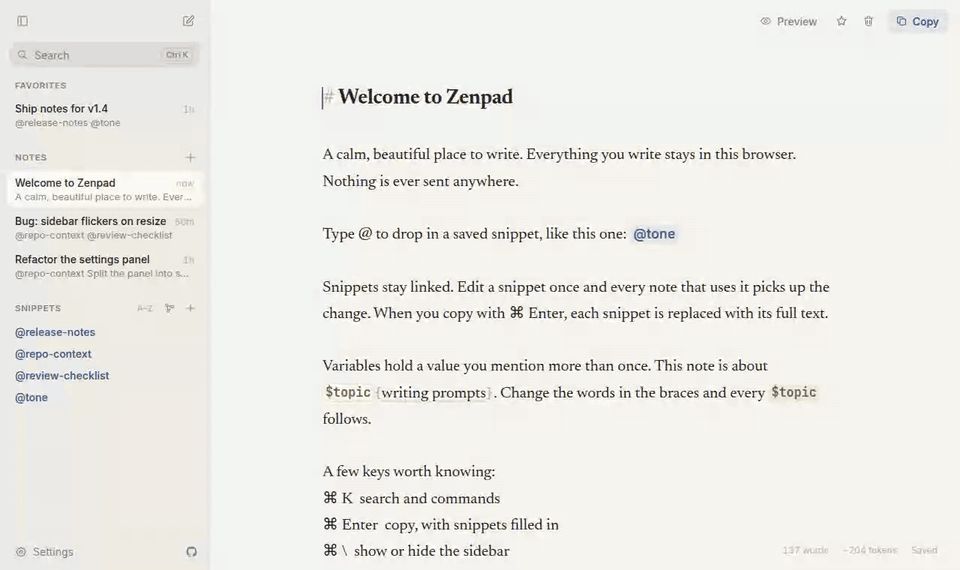

<p align="center">
  
</p>

<h1 align="center">Zenpad</h1>

<p align="center">
  A calm, beautiful place to write, with reusable <code>@snippets</code>.<br>
  Private, offline, and entirely in your browser.
</p>

<p align="center">
  <a href="https://zenpad.pages.dev"><strong>Open Zenpad →</strong></a>
</p>

<p align="center">
  
</p>

Zenpad was built for writing AI prompts, but it works for any writing where you repeat yourself. Save the text you reuse as a snippet, type `@` to drop it into any note, and copy the note with everything filled in.

## Features

- **Focused writing.** One centered page in a warm serif. The chrome fades away while you type.
- **@snippets.** Snippets stay linked, so editing one updates every note that uses it. They can nest, and loops are caught.
- **Templates.** Any snippet can also be pasted as plain text you're free to edit: press `⇧ Enter` on it in the `@` list, or run **Paste snippet text…** from `⌘ K`. The pasted copy won't change when the snippet does, but any `@snippets` and `$variables` inside it stay live.
- **$variables.** Set `$branch = fix/login` once, or inline as `$branch{fix/login}`, and use `$branch` anywhere in the note. Snippets can use them too.
- **Folded blocks.** Keep long context in a note without it taking over the page: put it between `$context = """` and `"""`, and it folds into a one-line chip. The text fills in right where the block sits, and `$context` repeats it anywhere else. Or paste the text, select it, and click **Fold away** to fold it in place.
- **Checklists.** Write `- [ ]` or press `⌘ ⇧ L` to turn lines into a checklist, then click a circle to check it off. The status bar shows how far along the note is, and in the sidebar a small pie fills in beside the count of done tasks, turning into a check mark once every one is done.
- **Comments.** Start a line with `//` to leave a note to yourself. Comments stay in the note but are left out when you preview or copy. `⌘ /` comments out the selected lines, or uncomments them.
- **Preview and copy.** See the note exactly as it will be copied, with every snippet and variable filled in.
- **Snippet map.** An interactive graph of your snippets and the notes that use them.
- **Grouped by date.** The sidebar lists notes under Today, Yesterday, Previous 7 days, Previous 30 days, then by month and year. Click a heading to collapse it. Switch to one list with the button beside Notes, or in Settings.
- **Search and commands.** `⌘ K` finds any note or snippet and runs any command. Results are ranked by best match across all three, with title hits first, then initials (`tfm` finds "Toggle focus mode"), then matches in the text.
- **Private by design.** No server, no accounts, no analytics, and a strict Content Security Policy that blocks network requests.
- **Works offline.** Install it as an app (PWA). Light and dark themes, plus serif, sans, and mono fonts.

## Keyboard

| Keys | Action |
| --- | --- |
| `⌘ K` | Search and commands |
| `⌘ Enter` | Copy with snippets filled in |
| `⌘ E` | Preview with snippets filled in, or back to editing |
| `⌘ ⇧ L` | Turn the selected lines into a checklist, or back |
| `⌘ ⇧ Enter` | Check off the task the cursor is on |
| `⌘ /` | Turn the selected lines into comments, or back |
| `⌘ \` | Show or hide the sidebar |
| `⌘ ⌥ N` | New note |
| `⇧ Enter` in the `@` list | Paste the snippet's text instead of linking it |
| `⌘ click` an `@snippet` | Open it, or create it if it doesn't exist |
| `⌘ click` a `$variable` | Jump to its value, ready to change |
| `⌘ F` | Find in the current note |

On Windows and Linux, use `Ctrl` in place of `⌘`.

## Snippets and variables

- **Snippet names** use lowercase letters, numbers, `-`, and `_`, like `@repo-context`. An `@` right after a letter or number is ignored, so `me@site.com` is left alone. Renaming a snippet updates every reference to it.
- **Variable names** start with a letter and use letters, numbers, `-`, and `_`. Case matters, so `$PR` and `$pr` are different. Only names the note sets are filled in, so `$HOME` or `$5` stay as written.
- `$name = value` lines are left out when you copy or preview. Inline `$name{value}` copies as just the value.
- For a value that spans several lines, start with `$name = """` on a line of its own and end with a line of just `"""`. Click the chip to show the text and **Fold** to hide it again; each note remembers which blocks you left open, and the rest start folded. Like `$name{value}`, a block fills in its text where it sits when you copy, and `$name` repeats it elsewhere. A block without its closing `"""` is not a block yet.
- **Fold away** (next to Make a snippet, above selected text in a note) folds the lines the selection touches into a `$context` block right where they are, so the note copies exactly as before. The name is selected afterwards, so type to rename it.
- **Comments** are whole lines that start with `//` (spaces before it are fine). They're left out of the copy and preview in notes and snippets alike, along with any blank line that only separated them from the text, and an `@snippet` or `$variable` that only a comment mentions isn't filled in. A snippet mentioned only in comments doesn't count as used in the sidebar, the snippet map, or the delete warning, but renaming it still updates those mentions. Text like `https://site.com` or `a // b` isn't a comment, and lines inside fenced code blocks (```` ``` ````) are copied as written, so code keeps its own comments. Folded `$name = """` blocks aren't code, so `//` lines inside them are comments too; wrap pasted code in a fence to keep its comments. Comment lines are skipped when picking a note's title and sidebar preview.
- A snippet's `$pr` is filled in from the note it is copied from, so one `@review-pr` snippet works for every PR.

## Checklists

- Checklists are plain Markdown task lists: `- [ ] to do` and `- [x] done`, with `*`, `+`, or a number in place of `-`. They copy exactly as written.
- `Enter` carries a checklist on to the next line, and `Enter` on an empty task ends it. `Backspace` at the start of a task removes its box.
- Progress counts every task in the note, nested ones included. Tasks inside fenced code blocks are left out.

## Your data

Notes and snippets live in this browser's IndexedDB and never leave it. Clearing site data can delete them, so **export a backup** from Settings now and then. Importing a backup merges it, and the newer copy of each note or snippet wins.

## Development

Requires Node 20.19 or newer.

```bash
npm install
npm run dev        # start the dev server
npm test           # unit tests
npm run build      # production build in dist/
npm run test:e2e   # browser smoke tests (after npm run build)
```

To fill a local library with test data, run **Add sample data** from the command palette (`⌘ K`) in `npm run dev`. It adds about 20 notes and 14 snippets, including nested snippets, variables, a snippet loop, and a missing reference. `npm run build:sample` makes a build that seeds the same data on first launch; pull request previews use it. The command is left out of production builds.

Built with Vite, React, TypeScript, CodeMirror 6, and Dexie, and deployed to Cloudflare Pages from `main`. See [AGENTS.md](AGENTS.md) for the project layout, conventions, and CI.

## License

[MIT](LICENSE)
